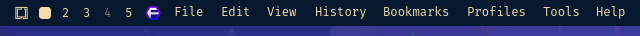
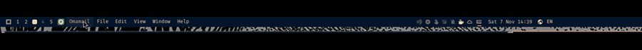
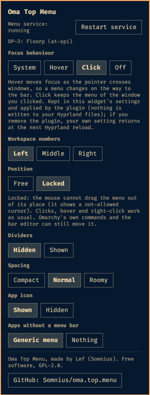
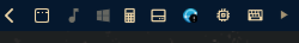

# Oma Top Menu

The focused app's menus (File, Edit, View...) on the left of the Omarchy top bar, like a macOS or GNOME global menu. The workspace numbers can sit on the right.

Plugin id: `com.lefteros.somnius.oma-top-menu` (codename `oma.top.menu`). Status: early work in progress, 0.1.0, not listed on the marketplace yet.





## What it does
- A bar widget shows the menu of the window on that monitor and lets you click through it.
- **Each monitor has its own menu.** The monitor you are using shows its focused window's menu; every other monitor shows the menu of the window on the workspace it is displaying. Different workspaces and apps on different monitors give different menus, and a monitor with no window shows nothing.
- A background service (started by the plugin itself, one per shell) reads each menu from the app: `org.gtk.Menus`, `dbusmenu`, then the accessibility tree (AT-SPI). Apps without a menu bar of their own get a generic menu. With several windows of one app, the menu of the window whose title matches is used.
- Sandboxed apps (whose accessibility pid differs from the window pid) are matched by name.

## Moving the menu
Drag the menu strip anywhere along the bar with the mouse (Omarchy's own bar drag-and-drop), or lock it in place in the options. Clicking still opens the menu; only dragging moves it.



Details, supported places and how the lock works: [docs/moving-the-menu.md](docs/moving-the-menu.md).

## Options panel
**Right-click the menu strip** to open the options panel. (Optionally add the widget a second time, on the right next to the tray or inside the tray drawer, to get a small options icon there: where a copy is placed decides what it is. The left section is the menu; anywhere else is the icon; the centre sections are not supported. Use `omarchy plugin remove` and the uninstall helper below to leave no extra entry behind.)



The optional options icon sits next to the tray chevron:



- **Focus behaviour**: *System* (leave your Hyprland setting alone), Hover, Click or Off. Hover is Omarchy's default and moves focus as the pointer crosses windows, so a menu changes on the way to the bar; Click keeps the menu of the window you clicked. The choice is a setting of this widget (kept in `shell.json`) and the plugin applies it with `hyprctl`, again after every Hyprland reload. **No Hyprland file is edited**, and removing the plugin ends it (your own value returns at the next reload).
- **Workspace numbers**: Left (just before the menu), Middle or Right (the start of that section), done with `omarchy bar move omarchy.workspaces ...` when you click it.
- **Position**: Free, or Locked (puts the menu back if it is dragged away).
- **Dividers**, **Spacing** (compact, normal, roomy), **App icon**, **Apps without a menu bar** (generic menu or nothing). These are the widget's settings in `shell.json`.
- **Restart menu service**, and a **GitHub** button with a small creator note.

Every action the plugin takes, and how to undo it, is listed in [docs/actions.md](docs/actions.md). The Omarchy internals it relies on are in [docs/internals.md](docs/internals.md).

## Requirements
- Omarchy with the Quattro shell, Hyprland.
- `python-gobject` and `at-spi2-core` (the plugin checks for them and says so in the bar if they're missing): `sudo pacman -S python-gobject`.
- It uses `/usr/bin/python3`.

## Install
```
omarchy plugin add https://github.com/Somnius/oma.top.menu
```
Then put the widget in the left section of the bar (Omarchy's bar editor, or `omarchy bar put com.lefteros.somnius.oma-top-menu --section left`).

## Remove
```
bin/oma-top-menu-uninstall            # shows what it would clean
bin/oma-top-menu-uninstall --apply    # cleans it (backs up shell.json first)
omarchy plugin remove com.lefteros.somnius.oma-top-menu
```
A plain `omarchy plugin remove` is safe too: the daemon stops with the plugin, nothing is edited in your Hyprland files, and nothing of ours stays on disk except, if you added the optional second copy, its leftover entry in `shell.json` (which draws nothing and does no harm). The helper removes that entry as well. State lives in the runtime folder (cleared at logout).

## Recommended: focus on click, not on hover
With Omarchy's default (`follow_mouse = 1`) the menu follows the pointer across windows. Choose **Click** in the options panel for a menu that stays with the window you clicked. If you would rather set it in your own Hyprland config, put `follow_mouse = 2` in `~/.config/hypr/input.lua` and leave the panel on *System*.

## Side effect to know about
To get menus out of Qt and GTK4 apps, the service registers an AT-SPI listener, which turns accessibility on for the whole session while it runs (`org.a11y.Status IsEnabled` becomes true). It goes back when the service stops. The cost of that is not measured yet.

## Updates and compatibility
Tested on Omarchy 4.5.0-3 with Hyprland 0.56.2. See [docs/compatibility.md](docs/compatibility.md) for what the plugin depends on, how plugin updates behave, and the checks to run after an Omarchy update (`python3 tests/check_shell_api.py`).

## Known limits
- Firefox-family browsers (tested: Floorp) only fill a menu after it has been opened once, so some entries are empty at first and a click opens the menu inside the app. The menus you have already opened show up in the bar.
- Apps that were already running before the service started keep an empty accessibility tree until restarted.
- Apps with no menu bar (terminals, many GTK4 apps) get the generic menu.

## Credits
Based on [primo.global-menu](https://github.com/PrimoGameStudio/primo.global-menu) by PrimoGameStudio (GPL-2.0). Inspired by the Global Menu GNOME extension by [Unmade760](https://github.com/Unmade760/orbit-global-menu).

Built with Claude Code; JEV (TypeSafe) was used to classify the marketplace catalog.

## License
GPL-2.0, see [LICENSE](LICENSE).

## Docs
[SPECS.md](SPECS.md), [ROADMAP.md](ROADMAP.md), [AGENTS.md](AGENTS.md), [NOTES.md](NOTES.md), [docs/](docs).
