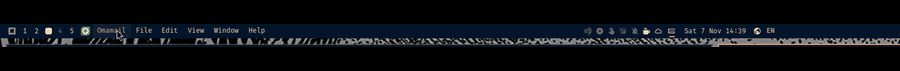

# Moving the menu, and locking it in place

*(The recording as a video: [moving-the-menu.mp4](media/moving-the-menu.mp4).)*

## What the recording shows
The menu strip can be picked up and moved, using Omarchy's own bar drag-and-drop (the plugin does nothing special for this):

1. Press the strip with the left mouse button and move the pointer a few pixels (or press and hold). A boxed copy of the strip lifts off and follows the pointer.
2. Drag it along the bar. The other widgets slide out of the way as it passes over them.
3. Let go to drop it in the new place. In the recording it is carried across the bar to the right and then dragged back to its original spot on the left.

A plain click, without moving, still opens the menu under it, so clicking and dragging do not get in each other's way. The workspace numbers and the other widgets are moved the same way.

## Where it can go
- **Left section**: the menu strip (the default place).
- **Right section, or the tray drawer**: the widget becomes the small options icon instead of the strip, because where a copy sits decides what it is. So dragging the strip to the right turns it into the options icon; drag it back to the left to get the menu again.
- **Centre sections** are not supported (the bar gives a widget no reliable signal there).

## Locking it in place
Right-click the strip to open the options and choose **Position: Locked**. Then the mouse cannot pick the menu up at all: pressing and dragging does nothing and the pointer shows a not-allowed cursor. Clicking, hovering and right-clicking work as usual.

How it works: the bar starts a drag from a pointer area it lays over every widget, and it gives a widget no way to refuse (this is one switch for the whole bar). So while locked, the strip places its own transparent pointer area above that one, in the bar window's top layer. It takes the mouse press, so the bar never sees a drag begin, and it handles hover, click and right-click for the strip itself. Nothing is moved and moved back.

What the lock does not do:
- It guards against the mouse only. `omarchy bar move`, the bar editor or editing `shell.json` can still move the menu (and the plugin does not fight them).
- It guards the menu strip, not the optional options icon or any other widget.
- It exists only while the plugin is running and the strip is shown; disabling or removing the plugin removes the shield with it.
- The setting is stored with the widget in `shell.json` (`locked`), so it is removed with the plugin.

An earlier version of the lock let the drag happen and then put the menu back with `omarchy bar move` a couple of seconds later. That was replaced because it looked broken (the menu visibly left and came back).

## Tested
- Earlier snap-back design (replaced): see git history.
- Shield: loads without errors; logs `shield on` and `blocked a drag of the locked menu` when a drag is attempted. Hand-testing with a real mouse is recorded in docs/compatibility.md.
